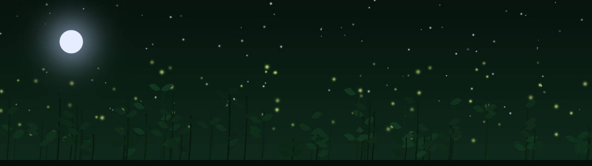

<h1 align="center"> Herbalore</h1>

<i>A voice for every herb.</i>

<b><a href="https://rainbowpusheenthe3rd.github.io/herbalore/">Listen to it →</a></b>

A World of Warcraft addon, voiced in one designed night elf voice. Made for the Forever client (interface 16001,
also 120105).

## What it does

- **Every herb has three lines,** from Peacebloom to Black Lotus: what it is, where it likes to grow, or something worth noticing. The ones you haven't heard come first.
- **Nothing nags.** Each line, and each herb, rests longer every time it's spoken (5 minutes, then 10, then 20 for a herb; 20, 40, 80 for a line), so an evening's gathering stays fresh.
- **Quiet lines.** Now and then, instead of a herb's line, a word about slowing down: gathering as a kind of listening.
- **Skinning.** A word of thanks the first time each session, then now and then. Every hide is a life given.
- **Shares the air with Shan'do.** Never in combat, never within 45 seconds of Shan'do or of itself.
- **A notebook.** Account-wide, Herbalore notes where each herb was picked (for drawing herb routes) and anything gathered that has no line yet (so it can get one). It stays in your saved variables.
- **Minimap button** at half opacity: left-click for the guide, right-click to turn it off or on, drag to move.

## Install

Download this repository (Code → Download ZIP), and copy the `Herbalore` folder into
`World of Warcraft\_<flavour>_\Interface\AddOns`. Restart the game fully the first time, so its saved variables
are created.

## Commands

| Command | |
|---|---|
| `/herbalore` | turn it off or on |
| `/herbalore help` | the in-game guide |

## Spoilers

Every line is in `Herbalore/Lines.lua`. If you'd like to be surprised, don't open it.

## Also

**Shan'do**, the night elf spirit guide it was made beside: [github.com/rainbowpusheenthe3rd/shando](https://github.com/rainbowpusheenthe3rd/shando)

## Credits

The voice is AI-generated with [VoxCPM2](https://huggingface.co/openbmb/VoxCPM2) (Apache-2.0): designed once from a
description and used for every line, with a soft moonwell reverb. Every other sound, the icon and the banner are
synthesised from scratch with numpy. Not affiliated with or endorsed by Blizzard Entertainment; World of Warcraft and
its names belong to Blizzard. Code and assets are MIT licensed.
